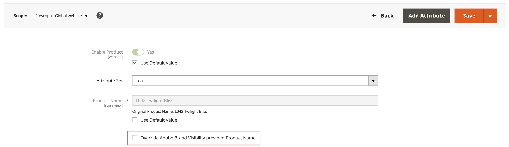
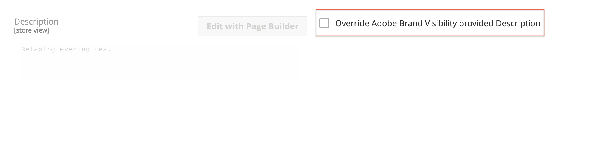

# 目录扩充

目录扩充是一项原生[!DNL Adobe Commerce]功能，可帮助您改进产品名称和长描述，以便在购物者使用LLM和AI助手进行产品研究和发现时，更准确地表示您的目录。

## 工作原理 {#how-it-works}

您的[!DNL Adobe Commerce]产品目录是产品数据的记录系统：名称、描述、属性、定价和库存。 [!DNL Adobe Commerce]将实时目录数据连接到Adobe AI体验。 从那里，目录代理可以识别产品名称和详细描述中的空白，提出改进建议，并将批准的更改写回Commerce，以便您可以在Commerce管理员中查看这些更改。

通过目录扩充，您可以：

- 确定产品名称中的差距和不一致之处以及影响LLM解释产品的详细描述。
- 审查在支持情境方面建议的改进，包括理由和前后比较。
- 将批准的更新直接应用于Commerce目录，以使管理员、店面和其他读取这些字段的渠道保持一致。

由于产品名称和长描述存在于Commerce中，因此改进一次复制可以使使用该产品数据的每个渠道受益。 其优势取决于系统更新的方式和时间。

| 方向 | 用途 |
| --- | --- |
| Commerce目录 — >分析 | 目录和代理流量信号揭示丰富建议机会。 |
| 扩充 — > Commerce目录 | 批准更新后，对产品名称和描述所做的更改将保存到Commerce目录中，以便管理员和店面反映优化后的值。 |

### 访问目录扩充

在开始之前，请查看特定于部署的[AI产品发现先决条件](prerequisites.md)。 完成Commerce平台的设置后，在管理员中转到&#x200B;**[!UICONTROL AI Product Discovery]** > **[!UICONTROL Catalog Enrichment]**。

{zoomable="yes"}

目录扩充工作区包括&#x200B;**[!UICONTROL Optimizations]**、**[!UICONTROL Brand governance]**&#x200B;和&#x200B;**[!UICONTROL Settings]**&#x200B;选项卡。

- 使用&#x200B;**[!UICONTROL Optimizations]**&#x200B;选项卡可查看基于代理流量的发现信号和管理扩充作业。
- 使用&#x200B;**[!UICONTROL Brand Governance]**&#x200B;选项卡[定义[!DNL Commerce Catalog Agent]生成的产品名称和说明的要求](brand-governance.md)。
- 使用&#x200B;**[!UICONTROL Settings]**&#x200B;选项卡将Commerce实例](settings.md)连接到AI产品发现。[

该共享扩展还支持PDP扩充，后者具有向AI代理公开结构化产品事实的独立工作流。 请参阅[产品详细信息页面扩充](pdp-enrichment.md)。

## 目录扩充的两条途径

接收目录增强的路径有两种：

- **代理流量** — 此类型的扩充会在您配置Commerce实例后24-48小时自动开始，并在&#x200B;**优化**&#x200B;选项卡上显示结果。
- **扩充管理器** — 商家在单击&#x200B;**[!UICONTROL Create enrichment]**&#x200B;按钮并手动选择要扩充的SKU时配置这些扩充。 了解有关[扩充管理器](#create-an-enrichment-job)的更多信息。

### 查看并应用目录扩充 {#review-and-apply}

启用和配置目录扩充后，使用&#x200B;**[!UICONTROL Optimizations]**&#x200B;选项卡可查看搜索和代理流量分析并管理扩充作业。

### 审查每月代理流量

每个月的代理流量审核都会识别高流量SKU，并提供建议的批处理。 系统会自动为高智能流量SKU生成优化以供审阅。 这些优化会根据您的“默认”治理规则自动生成。 每月信息卡显示产品计数、AI代理访问次数和作业状态。 代理流量和自我选择的批次使用相同的规则选择、确认、运行、查看和部署工作流。

### 查看需要关注的作业

**[!UICONTROL Needs your attention]**&#x200B;部分突出显示需要操作的作业，包括已完成的等待审阅的作业。 打开已完成的作业，以在部署之前查看其建议的产品更改。

### 查找作业

**[!UICONTROL All jobs]**&#x200B;表列出了每个作业ID、名称、来源、SKU计数、使用的规则、开始时间和状态。 源标识是自行选择批次还是从代理流量中推荐批次。 以&#x200B;**[!UICONTROL Queued]**、**[!UICONTROL Running]**、**[!UICONTROL Completed]**&#x200B;或&#x200B;**[!UICONTROL Failed]**&#x200B;跟踪处理状态。 在“优化”工作区中，这些作业还可以在运行时显示为&#x200B;**[!UICONTROL Generating]**，在生成完成时显示为&#x200B;**[!UICONTROL Ready to review]**，在部署批准的更改后显示为&#x200B;**[!UICONTROL Deployed]**。 您可以同时运行多个作业。 使用&#x200B;**[!UICONTROL Retry]**&#x200B;重试失败的作业。

### 创建扩充作业

**要创建目录扩充：**

{zoomable="yes"}

1. 在&#x200B;**[!UICONTROL Optimizations]**&#x200B;中，单击&#x200B;**[!UICONTROL Create enrichment]**。
1. 输入&#x200B;**扩充名称**，如“Black Friday 2026”。
1. Select **类别**，如“咖啡”。
1. Select **属性集**，如“附件”。
1. Select **产品类型**，如“简单产品”。
1. 在&#x200B;**价格范围**&#x200B;内Select。
1. 单击&#x200B;**[!UICONTROL Apply filters]**。

   您可以预览符合扩充条件的产品，然后单击&#x200B;**自定义**&#x200B;以进一步限定要扩充的产品。

1. 单击&#x200B;**[!DNL Next]**&#x200B;并预览应用于您的扩充的[治理规则](brand-governance.md)。
1. 单击&#x200B;**[!DNL Next]**&#x200B;以确认要扩充的特定产品。
1. 单击&#x200B;**[!DNL Run enrichment]**。

   扩充作业运行并显示在“优化”表格中。 当它完成运行时，您可以[查看和部署](#review-deploy-catalog)优化。

### 查看和部署扩充作业 {#review-deploy-catalog}

打开扩充作业。

{zoomable="yes"}

带有建议&#x200B;**表的** URL列出了具有扩充机会的所有产品。 对于每个产品，您可以：

- **展开行**&#x200B;以查看AI分析和建议的扩充。
- **在申请之前编辑**&#x200B;建议的产品名称或描述，以符合您的品牌声音和促销准则。
- 为要扩充的产品部署优化&#x200B;****，并将其直接发布到Adobe Commerce目录。
- 在审核和应用扩充后&#x200B;**标记为已固定**。
- **忽略**&#x200B;与您的目录策略无关的建议。

建议分为三个视图：**当前建议**、**固定建议**&#x200B;和&#x200B;**忽略的建议**。 应用扩充后，该扩充将移动到状态为&#x200B;**已应用**&#x200B;并在目录中查看&#x200B;**的固定建议中**&#x200B;操作，以在Adobe Commerce中验证更新。 可以随时回滚应用的增强功能，恢复原始产品名称和描述。

## 在管理员中验证扩充 {#verify-in-admin}

**要验证应用的目录扩充：**

1. 在Commerce管理员中转到&#x200B;**[!UICONTROL Catalog]** > **[!UICONTROL Products]**。
1. 根据需要使用筛选器和&#x200B;**[!UICONTROL Store View]**&#x200B;选择器（例如，**[!UICONTROL Default Store View]**）。
1. 搜索SKU。
1. 在编辑模式下打开产品。

   产品表单显示扩充的产品名称和/或描述。

   {zoomable="yes"}

1. 可选：如果要保留手动输入的名称，请选择&#x200B;**[!UICONTROL Override Catalog Agent provided Product Name]**。

   手动覆盖会影响建议如何与目录保持同步。 有关详细信息，请参阅管理员中的[手动覆盖](#manual-override-in-the-admin)。

1. 展开&#x200B;**[!UICONTROL Content]**&#x200B;部分并找到描述字段。

   应用说明更改时，将显示扩充说明。

   {zoomable="yes"}

1. 可选：如果要保留手动输入的描述，请选择&#x200B;**[!UICONTROL Override Catalog Agent provided Description]**。

手动覆盖会影响建议如何与目录保持同步。 有关详细信息，请参阅管理员中的[手动覆盖](#manual-override-in-the-admin)。

## 验证店面上的扩充 {#verify-storefront}

**验证店面的扩充：**

1. 在您的店面中搜索SKU。
1. 打开产品页面。
1. 确认产品名称和描述与您批准的内容相匹配。

   你的店面可能需要一些时间才会出现丰富内容。

1. 确认显示详细描述的区域与您批准的内容相匹配。
1. 可选：确认使用与转出相关的相同目录属性的下游渠道。

## 覆盖、引入和过时的建议 {#overrides-ingestion}

在目录扩充更新产品的名称或描述后，其他摄取系统可能会更改相同的字段。 示例包括REST API调用、CSV导入和PIM馈送。

### 已重新摄取原始值 {#original-value-reingested}

如果外部进程写入原始名称或描述（在应用扩充之前存在的值），则Commerce会继续根据目录扩充规则遵循该字段的扩充值。 仅根据摄取，建议可能不会自动恢复。

### 已重新摄取新值 {#new-value-reingested}

如果外部流程发送的新值不是预扩充文本的重复，则Commerce将遵循新目录值。 例如，将“Red Shoes”重命名为“Iconic Red Shoes”会替换扩充值。 相关扩充建议通常标记为&#x200B;*已过时*，因为实时目录不再与建议上下文匹配。

### 管理员中的手动覆盖 {#manual-override-in-the-admin}

如果您在[!DNL Adobe Commerce]管理员中手动编辑产品名称或描述：

- Admin值作为该手动更改的记录系统而获胜。
- 扩充建议标记为&#x200B;*已过时*。
- 建议工作流会移回该项的原始状态，以便您可以重新基线或在分析再次运行时接受新的建议。

这些规则可帮助您了解当多个渠道接触同一SKU时，目录扩充、摄取馈送或管理员编辑是否具有权威性。

## 限制和注意事项 {#limits}

- 扩充仅适用于产品名称和详细说明。 它不会更改产品详细信息页面布局、小组件或其他页面级别的店面内容。
- 大型目录和高的URL计数可能会影响分析完成的速度以及同时显示的建议数量。
- 有意义的建议假定与LLM相关的机器人可以访问您关注的产品URL。 机器人规则、身份验证、地理阻挡和高度个性化可能会减少覆盖范围。

## 最佳实践 {#best-practices}

- 产品名称和描述的文档系统所有权，以便PIM或信息源作业不会无意中与目录扩充冲突。
- 在批量应用标题或描述之前，请与SEO和品牌团队协调。
- 主要目录导入后重新同步或重新分析，以便建议反映当前目录状态。

## 示例

以下示例显示了目录扩充如何将原始技术属性转换为以购物者为中心的叙述性产品副本，LLM可以使用该副本来回答购物问题。

### 示例：具有技术属性的咖啡产品

一种咖啡retailer目录，仅存储中烧咖啡豆产品的技术规格：豆类、产地、加工方法、烧烤等级和高度。 这些字段描述的是产品，但不会向购物者传达它的价值，因此，在回答“什么咖啡具有顺滑、低酸的味道？”这类问题时，AI助手几乎没什么可做的。

目录扩充通过技术属性和原因的交互方式推断购物者相关特征：

| 技术属性 | 推断的特征 | 推理 |
| --- | --- | --- |
| 蜂蜜加工，Medium烤肉 | 低酸度 | 在蜂蜜加工过程中留在豆子上的果胶会抑制酸性，而中间烤肉会分解残留的酸性化合物。 |
| 蜂蜜加工业，阿拉比卡，Medium烤肉 | 榛子味 | 来自粘液的水果糖与阿拉伯的天然坚果音相结合，在中等烘烤时放大。 |
| 蜂蜜加工业，阿拉比卡 | 口感丰富，奶油般滑爽 | 干燥期间从粘液中吸收的油增加了粘度和身体。 |
| 蜂蜜加工，海拔900-1200米 | 焦糖底色 | 高海拔的豆子密度更大，糖分更复杂，蜂蜜加工使糖分更加深化。 |

目录扩充将这些推断的特征应用于产品副本：

- **Before**：“Medium烤咖啡豆 — 阿拉比卡，巴西米纳斯吉拉斯，蜂蜜加工，900-1200米”
- **之后**：“在巴西米纳斯吉拉斯州以900-1200米种植的阿拉比卡豆子，经过蜂蜜加工和半熟烘烤，形成一种天然甜的、奶油味的口感，具有独特的榛子特征、焦糖底色和低酸度。 始终如一、平易近人的特色咖啡，最好在倒咖啡时体验。”

更新的名称和描述将直接保存到Commerce目录中，因此店面、LLM馈送和读取这些字段的其他渠道都反映了相同的扩充副本。

### 示例：模块化家具配置

家具retailer销售模块化组合沙发，其中产品说明仅列出配置代码和结构名称，例如`6 Standard Seats + 6 Standard Sides in Sapphire Navy Corded Velvet`。 对于回头客户来说，这种速记是可以理解的，但人工智能助手几乎没有提供产品如何发挥功能或哪些因素使其耐用或舒适的上下文。

目录扩充将配置和结构属性扩展为叙述性描述，说明每个组件的功能以及它对于购物者而言重要的原因：

- **Before**：“6个标准座椅+ 6个蓝宝石海军束绒天鹅绒标准侧面”
- **After**：“此配置包括6个标准座椅插入件集和6个标准侧插入件，它们可互换地用作臂或背部，构成布局的模块化构建块。 每张座椅均采用标准泡沫材料，其中具有三个高密度层，旨在保持提升和防止下垂。 蓝宝石海军灯丝绒护套既耐用，又豪华，其纹理丰富的灯丝营造出细腻的光泽，柔软而丰满的感觉。 封面是手工缝制的，外观精准、量身定制，可机洗，可更换，因此您的部分可以随您的空间而发展。”

由于扩充的描述会写回Commerce目录，因此可供抓取产品详细信息页面的AI机器人以及任何使用产品目录数据的下游渠道或馈送使用，而无需更改购物者在页面上看到的布局或设计。
