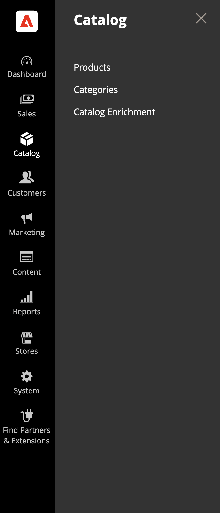
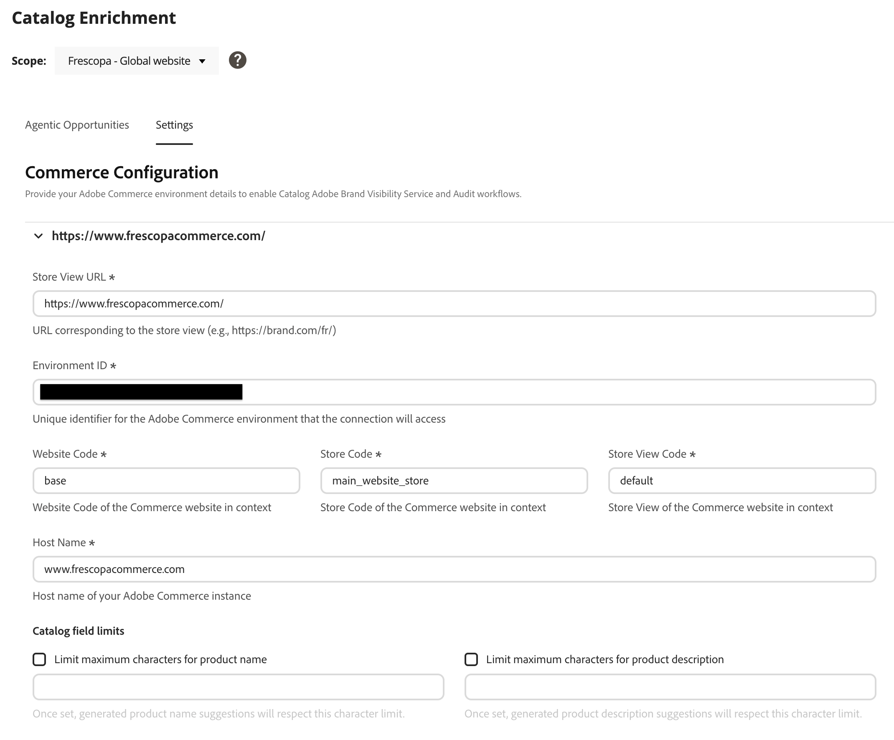
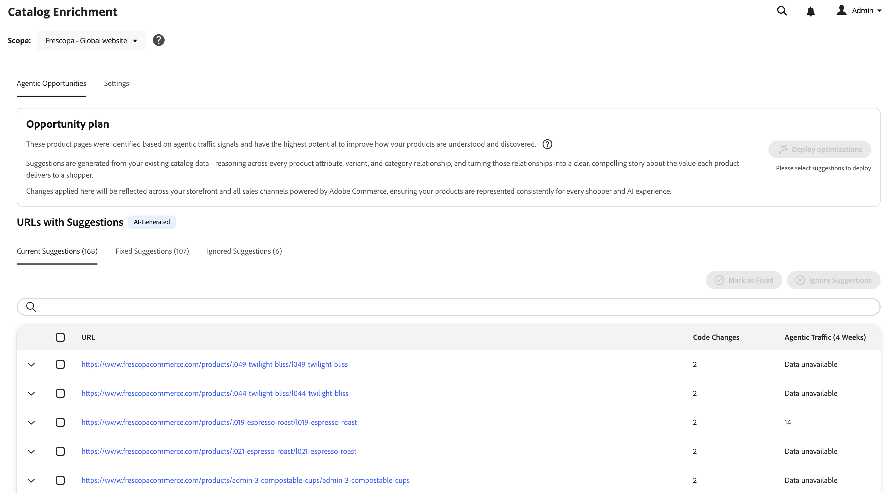
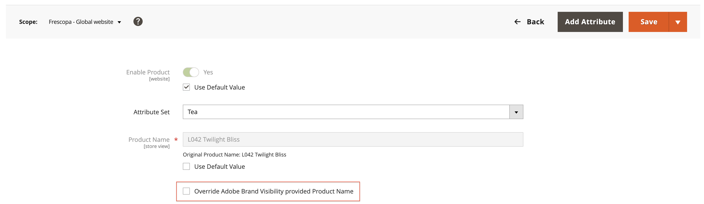
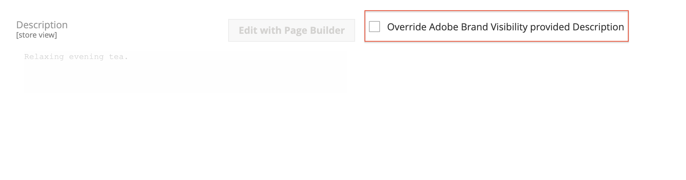

# 目录扩充

目录扩充是一项原生[!DNL Adobe Commerce]功能，可帮助您改进产品名称和长描述，以便在购物者使用LLM和AI助手进行产品研究和发现时，更准确地表示您的目录。

>[!NOTE]
>
>目录扩充由[!DNL Commerce Catalog Agent]和[!DNL Adobe Brand Visibility]在幕后提供支持。 您可以将扩充用作Commerce目录工作流的一部分。 您无需管理单独的Adobe Brand Visibility集成即可应用批准的名称和描述更新。 有关在Commerce之外进行更广泛的LLM监控和优化，请参阅[[!DNL Adobe Brand Visibility] 产品文档](https://experienceleague.adobe.com/zh-hans/docs/brand-visibility/using/home)。

## 工作原理 {#how-it-works}

您的[!DNL Adobe Commerce]产品目录是产品数据的记录系统：名称、描述、属性、定价和库存。[!DNL Adobe Commerce] Storefront MCP（模型上下文协议）将实时目录数据连接到Adobe AI体验。 从那里，目录代理可以识别产品名称和详细描述中的空白，提出改进建议，并将批准的更改写回Commerce，以便您可以在Commerce管理员中查看这些更改。

通过目录扩充，您可以：

- 确定产品名称中的差距和不一致之处以及影响LLM解释产品的详细描述。
- 审查在支持情境方面建议的改进，包括理由和前后比较。
- 将批准的更新直接应用于Commerce目录，以使管理员、店面和其他读取这些字段的渠道保持一致。

由于产品名称和长描述存在于Commerce中，因此改进一次复制可以使使用该产品数据的每个渠道受益。 其优势取决于系统更新的方式和时间。

| 方向 | 用途 |
| --- | --- |
| Commerce目录 — >分析 | 目录和URL信号提供扩充建议。 |
| 扩充 — > Commerce目录 | 批准更新后，对产品名称和描述所做的更改将保存到Commerce目录中，以便管理员和店面反映优化后的值。 |

## 这是给谁的 {#who-this-is-for}

- 希望产品数据在LLM驱动的答案中准确且一致的数字营销人员和营销人员。
- 需要以可控方式大规模改进目录复制的数字营销人员和营销人员。
- 拥有目录完整性、管理流程和用于提供产品属性的集成(API、CSV、PIM)的Commerce管理员。

## 先决条件 {#prerequisites}

当您有权访问目录扩充时，以下先决条件适用。

- 您的店面可以由面向LLM和代理的机器人抓取，这些机器人需要抓取范围才能获得目录感知建议。
- 所需的Commerce服务和目录连接已启用且运行正常。 请参阅[启用目录扩充](#enable-catalog-enrichment)以了解详情。
- 访问目录扩充的Commerce管理员用户通过Adobe IMS登录。 查看[IMS登录和组织要求](#ims-sign-in-requirements)。
- 您有权访问[Adobe Admin Console](https://helpx.adobe.com/cn/business/enterprise/plan-your-deployment/basic-concepts/admin-console.html)。
- 您的组织已签署底层AI服务的GenAI附加程序，或明确选择退出。

>[!NOTE]
>
>作为设置的一部分，Commerce会检查贵组织是否已签署GenAI附加程序，该附加程序涵盖目录扩充后的AI服务。 如果您尚未签名或选择退出，则系统将提示您签名或更新该附加条款，然后才能使用目录扩充。

### IMS登录和组织要求 {#ims-sign-in-requirements}

目录扩充使用登录的Commerce管理员用户的Adobe IMS访问令牌连接到[!DNL Adobe Brand Visibility]。 仅使用Commerce用户名和密码进行本机Commerce管理员登录不会生成此令牌，因此访问目录扩充的管理员用户必须通过Adobe IMS登录。

要支持IMS登录，您的Commerce实例必须启用Commerce管理与Adobe ID的集成。 请参阅[配置Commerce管理员与Adobe ID的集成](/help/getting-started/adobe-ims-config.md)。

>[!IMPORTANT]
>
>启用Commerce管理员与Adobe ID的集成是实例范围的更改。 启用后，每个管理员用户都必须通过Adobe IMS进行身份验证，并且本机Commerce用户名和密码登录将无法再使用。 在启用此集成之前，请查看[Adobe Identity Management Service (IMS)集成概述](/help/getting-started/adobe-ims-integration-overview.md)。

与您的Commerce实例关联的Adobe IMS组织通常与持有您的[!DNL Adobe Brand Visibility]权利的IMS组织不同。 启用Commerce管理员与Adobe ID的集成本身不会授予对品牌可见度权利的访问权限，并且不需要两个组织相同。 与您的Adobe管理员或帐户团队合作，确认您的设置中需要哪些IMS组织成员资格和帐户访问目录扩充。

## 启用目录扩充 {#enable-catalog-enrichment}

在查看或应用建议之前，请与Commerce管理员或实施合作伙伴合作以确保满足以下条件：

### 安装目录扩充和目录服务扩展

1. 在Commerce实例中安装目录扩充扩展并应用更改：

   ```bash
   composer require magento/module-catalog-enrichment:^2.1
   bin/magento setup:upgrade
   bin/magento cache:flush
   ```

   `setup:upgrade`启用该扩展，创建其数据库表，并授予管理员权限。 之后刷新缓存，使权限生效。 在生产模式下，还运行`bin/magento setup:di:compile`和`bin/magento setup:static-content:deploy`。

1. 如果您尚未安装目录服务，请[执行此操作](https://experienceleague.adobe.com/zh-hans/docs/commerce/catalog-service/installation#install-the-catalog-service-extension)。

   **[!UICONTROL Catalog enrichment]**&#x200B;现在可在您的Commerce实例中使用。

>[!IMPORTANT]
>
>目录扩充2.1.2及更高版本需要PHP 8.3或更高版本上的Adobe Commerce 2.4.7或更高版本，并且无法与[!DNL Adobe Brand Visibility]扩展(`magento/llm-optimizer`)一起安装。 如果已安装，请在升级之前将其删除。 请参阅发行说明中的[从早期版本升级](#upgrade-from-earlier-versions)。

### 访问目录扩充

安装目录扩充和目录服务扩充后，管理员可在&#x200B;**[!UICONTROL AI Product Discovery]** > **[!UICONTROL Catalog Enrichment]**&#x200B;下使用目录扩充功能。

{zoomable="yes"}

>[!NOTE]
>
>**[!UICONTROL AI Product Discovery]**&#x200B;菜单也列出了&#x200B;**[!UICONTROL Product Details Page Enrichment (Beta)]**。 产品详细信息页面扩充为测试版，尚未正式发布。

### 配置目录扩充 {#configure-catalog-enrichment}

在&#x200B;**[!UICONTROL Settings]**&#x200B;选项卡上配置目录扩充，以便[!DNL Commerce Catalog Agent]能够连接到[!DNL Adobe Commerce]环境，并在Commerce管理员中显示建议。

此选项卡上的字段标识目录扩充所连接到的Commerce环境和存储视图。 它们与拥有您的[!DNL Adobe Brand Visibility]权利的Adobe IMS组织不同。 查看[IMS登录和组织要求](#ims-sign-in-requirements)。

1. 在“管理员”中，转到&#x200B;**[!UICONTROL AI Product Discovery]** > **[!UICONTROL Catalog Enrichment]**。
1. 在页面顶部的&#x200B;**[!UICONTROL Scope]**&#x200B;列表中，选择要配置的商店视图，或保留&#x200B;**[!UICONTROL All Store Views]**&#x200B;以跨商店视图管理设置。
1. 打开&#x200B;**[!UICONTROL Settings]**&#x200B;选项卡。
1. 在&#x200B;**[!UICONTROL Commerce Configuration]**&#x200B;中，展开标记为其URL的存储区视图面板。

   提供您的[!DNL Adobe Commerce]环境详细信息以启用目录Adobe Brand Visibility服务和审核工作流。

   “目录扩充设置”选项卡上的{zoomable="yes"}

1. 输入商店视图所需的连接详细信息。

   - **[!UICONTROL Store View URL]**：对应于商店视图的URL（例如，`https://brand.example.com/fr/`）。
   - **[!UICONTROL Environment ID]**：连接访问的[!DNL Adobe Commerce]环境的唯一标识符。
   - **[!UICONTROL Website Code]**、**[!UICONTROL Store Code]**&#x200B;和&#x200B;**[!UICONTROL Store View Code]**： Commerce网站的网站、商店和商店视图代码。 这些值必须与您的Commerce管理员中的代码匹配。
   - **[!UICONTROL Host Name]**： [!DNL Adobe Commerce]实例的主机名。

1. 单击&#x200B;**[!UICONTROL Save]**。

保存后，请等待任何初始同步或验证作业完成，然后再依赖该存储视图的目录或审核结果。 产品建议可能需要24小时才能显示在&#x200B;**[!UICONTROL Catalog Enrichment]**&#x200B;页面上。

要删除商店视图配置，请展开该条目并单击&#x200B;**[!UICONTROL Delete]**。

#### 字段描述 {#commerce-connection-fields}

在&#x200B;**[!UICONTROL Commerce Configuration]**&#x200B;表单中，必填字段标有星号(*)。

| 字段 | 必填 | 描述 |
| --- | --- | --- |
| 商店视图URL | 是 | 与商店视图对应的URL（例如，`https://brand.example.com/fr/`）。 |
| 环境ID | 是 | 连接访问的[!DNL Adobe Commerce]环境的唯一标识符。 |
| 网站代码 | 是 | Commerce网站的网站代码。 |
| 商店代码 | 是 | Commerce网站商店代码。 |
| 存储视图代码 | 是 | Commerce网站的商店视图。 |
| 主机名 | 是 | [!DNL Adobe Commerce]实例的主机名。 |

### 查看并应用目录扩充 {#review-and-apply}

启用和配置目录扩充后，**[!UICONTROL Agentic Opportunities]**&#x200B;选项卡上将显示产品建议。 在此处，您可以查看建议并将批准的更新应用于Commerce目录中的产品名称和详细说明。

目录扩充使用以下工作流视图：

- **[!UICONTROL Current Suggestions]**：要审阅的新项目或活动项目。
- **[!UICONTROL Fixed Suggestions]**：已应用或解析的项。
- **[!UICONTROL Ignored Suggestions]**：您特意从操作中排除的项目。

{zoomable="yes"}

### 部署已批准的建议 {#review-deploy-catalog}

要部署已批准的建议，请执行以下操作：

1. 选择&#x200B;**[!UICONTROL Current Suggestions]**。
1. 单击URL或SKU行的展开控件以显示建议的产品名称和产品说明更新。
1. 查看建议，并确认其符合您的促销和SEO策略。

您可以在部署建议之前对其进行编辑，如果建议与您的策略不符，则将其移至&#x200B;**[!UICONTROL Ignored Suggestions]**。

1. 选择要更新的URL或SKU的行。
1. 单击&#x200B;**[!UICONTROL Deploy optimizations]**&#x200B;并确认。

批准的名称和描述更改会像其他产品更新一样保存到您的[!DNL Adobe Commerce]目录。

>[!IMPORTANT]
>
>将每个应用的更新视为生产目录更改。 使用常规的更改控制、暂存和QA实践。 仅在推销和SEO利益相关者就最终副本达成一致后应用更新。

应用更新后，建议将移动到状态为&#x200B;**标记为“已修复”**&#x200B;的&#x200B;**[!UICONTROL Fixed Suggestions]**。

## 在管理员中验证扩充 {#verify-in-admin}

**要验证应用的目录扩充：**

1. 在Commerce管理员中转到&#x200B;**[!UICONTROL Catalog]** > **[!UICONTROL Products]**。
1. 根据需要使用筛选器和&#x200B;**[!UICONTROL Store View]**&#x200B;选择器（例如，**[!UICONTROL Default Store View]**）。
1. 搜索SKU。
1. 在编辑模式下打开产品。

   产品表单显示扩充的产品名称和/或描述。

   {zoomable="yes"}

1. 可选：如果要保留手动输入的名称，请选择&#x200B;**[!UICONTROL Override Catalog Agent provided Product Name]**。

   手动覆盖会影响建议如何与目录保持同步。 有关详细信息，请参阅管理员中的[手动覆盖](#manual-override-in-the-admin)。

1. 展开&#x200B;**[!UICONTROL Content]**&#x200B;部分并找到描述字段。

   在您应用说明更改后，即会显示扩充说明。

   {zoomable="yes"}

1. 可选：如果要保留手动输入的描述，请选择&#x200B;**[!UICONTROL Override Catalog Agent provided Description]**。

手动覆盖会影响建议如何与目录保持同步。 有关详细信息，请参阅管理员中的[手动覆盖](#manual-override-in-the-admin)。

## 验证店面上的扩充 {#verify-storefront}

**验证店面的扩充：**

1. 在您的店面中搜索SKU。
1. 打开产品页面。
1. 确认产品名称和描述与您批准的内容相匹配。

   你的店面可能需要一些时间才会出现丰富内容。

1. 确认显示详细描述的区域与您批准的内容相匹配。
1. 可选：确认使用与转出相关的相同目录属性的下游渠道。

## 覆盖、引入和过时的建议 {#overrides-ingestion}

在目录扩充更新产品的名称或描述后，其他摄取系统可能会更改相同的字段。 示例包括REST API调用、CSV导入和PIM馈送。

### 已重新摄取原始值 {#original-value-reingested}

如果外部进程写入原始名称或描述（在应用扩充之前存在的值），则Commerce会继续根据目录扩充规则遵循该字段的扩充值。 仅根据摄取，建议可能不会自动恢复。

### 已重新摄取新值 {#new-value-reingested}

如果外部流程发送的新值不是预扩充文本的重复，则Commerce将遵循新目录值。 例如，将“Red Shoes”重命名为“Iconic Red Shoes”会替换扩充值。 相关扩充建议通常标记为&#x200B;*已过时*，因为实时目录不再与建议上下文匹配。

### 管理员中的手动覆盖 {#manual-override-in-the-admin}

如果您在[!DNL Adobe Commerce]管理员中手动编辑产品名称或描述：

- Admin值作为该手动更改的记录系统而获胜。
- 扩充建议标记为&#x200B;*已过时*。
- 建议工作流会移回该项的原始状态，以便您可以重新基线或在分析再次运行时接受新的建议。

这些规则可帮助您了解当多个渠道接触同一SKU时，目录扩充、摄取馈送或管理员编辑是否具有权威性。

## 限制和注意事项 {#limits}

- 扩充当前仅支持英语产品内容。
- 扩充仅适用于产品名称和详细说明。 它不会更改PDP布局、小组件或其他页面级店面内容。
- 大型目录和高的URL计数可能会影响分析完成的速度以及同时显示的建议数量。
- 有意义的建议假定与LLM相关的机器人可以访问您关注的产品URL。 机器人规则、身份验证、地理阻挡和高度个性化可能会减少覆盖范围。

## 最佳实践 {#best-practices}

- 产品名称和描述的文档系统所有权，以便PIM或信息源作业不会无意中与目录扩充冲突。
- 在批量应用标题或描述之前，请与SEO和品牌团队协调。
- 主要目录导入后重新同步或重新分析，以便建议反映当前目录状态。

## 示例

以下示例显示了目录扩充如何将原始技术属性转换为以购物者为中心的叙述性产品副本，LLM可以使用该副本来回答购物问题。

### 示例：具有技术属性的咖啡产品

一种咖啡retailer目录，仅存储中烧咖啡豆产品的技术规格：豆类、产地、加工方法、烧烤等级和高度。 这些字段描述的是产品，但不会向购物者传达它的价值，因此，在回答“什么咖啡具有顺滑、低酸的味道？”这类问题时，AI助手几乎没什么可做的。

目录扩充通过技术属性和原因的交互方式推断购物者相关特征：

| 技术属性 | 推断的特征 | 推理 |
| --- | --- | --- |
| 蜂蜜加工，Medium烤肉 | 低酸度 | 在蜂蜜加工过程中留在豆子上的果胶会抑制酸性，而中间烤肉会分解残留的酸性化合物。 |
| 蜂蜜加工业，阿拉比卡，Medium烤肉 | 榛子味 | 来自粘液的水果糖与阿拉伯的天然坚果音相结合，在中等烘烤时放大。 |
| 蜂蜜加工业，阿拉比卡 | 口感丰富，奶油般滑爽 | 干燥期间从粘液中吸收的油增加了粘度和身体。 |
| 蜂蜜加工，海拔900-1200米 | 焦糖底色 | 高海拔的豆子密度更大，糖分更复杂，蜂蜜加工使糖分更加深化。 |

目录扩充将这些推断的特征应用于产品副本：

- **Before**：“Medium烤咖啡豆 — 阿拉比卡，巴西米纳斯吉拉斯，蜂蜜加工，900-1200米”
- **之后**：“在巴西米纳斯吉拉斯州以900-1200米种植的阿拉比卡豆子，经过蜂蜜加工和半熟烘烤，形成一种天然甜的、奶油味的口感，具有独特的榛子特征、焦糖底色和低酸度。 始终如一、平易近人的特色咖啡，最好在倒咖啡时体验。”

更新的名称和描述将直接保存到Commerce目录中，因此店面、LLM馈送和读取这些字段的其他渠道都反映了相同的扩充副本。

### 示例：模块化家具配置

家具retailer销售模块化组合沙发，其中产品说明仅列出配置代码和结构名称，例如`6 Standard Seats + 6 Standard Sides in Sapphire Navy Corded Velvet`。 对于回头客户来说，这种速记是可以理解的，但人工智能助手几乎没有提供产品如何发挥功能或哪些因素使其耐用或舒适的上下文。

目录扩充将配置和结构属性扩展为叙述性描述，说明每个组件的功能以及它对于购物者而言重要的原因：

- **Before**：“6个标准座椅+ 6个蓝宝石海军束绒天鹅绒标准侧面”
- **After**：“此配置包括6个标准座椅插入件集和6个标准侧插入件，它们可互换地用作臂或背部，构成布局的模块化构建块。 每张座椅均采用标准泡沫材料，其中具有三个高密度层，旨在保持提升和防止下垂。 蓝宝石海军灯丝绒护套既耐用，又豪华，其纹理丰富的灯丝营造出细腻的光泽，柔软而丰满的感觉。 封面是手工缝制的，外观精准、量身定制，可机洗，可更换，因此您的部分可以随您的空间而发展。”

由于扩充的描述会写回Commerce目录，因此可供抓取产品详细信息页面的AI机器人以及任何使用产品目录数据的下游渠道或馈送使用，而无需更改购物者在页面上看到的布局或设计。

## 发行说明 {#release-notes}

这些发行说明捕获了目录扩充扩展(`magento/module-catalog-enrichment`)中的添加和修复：

新功能
修复和改进
已知问题

### v2.1.2

*2026年10月22日*

[!BADGE 支持]{type=Informative tooltip="支持"} PHP 8.3到8.5上的Adobe Commerce 2.4.9、2.4.8、2.4.7。

版本2.1.2将目录扩充作为自含扩展。 它现在包含以前由单独的[!DNL Adobe Brand Visibility]扩展(`magento/llm-optimizer`)提供的所有内容：将批准的建议应用于目录、回滚这些建议，以及保护您自己的编辑内容不被覆盖。

#### 从早期版本升级 {#upgrade-from-earlier-versions}

>[!IMPORTANT]
>
>版本2.1.2不能与[!DNL Adobe Brand Visibility]扩展一起安装。 如果已安装，请在升级过程中将其删除。

1. 删除[!DNL Adobe Brand Visibility]扩展（如果已安装）：

   ```bash
   composer remove magento/llm-optimizer
   ```

   如果该扩展是通过将`Magento/LlmoCatalog`复制或符号链接到`app/code`中安装的，请删除该目录。 不仅要禁用模块：磁盘上仍存在的已禁用模块可能会导致`setup:upgrade`删除存储扩充产品原始值的表。

1. 更新目录扩充并应用更改：

   ```bash
   composer require magento/module-catalog-enrichment:^2.1
   bin/magento setup:upgrade
   bin/magento cache:flush
   ```

   升级后刷新缓存。 升级会将现有访问授权移动到新权限资源，并且这些授权在清除缓存之前不会生效。

#### 要求

 **PHP 8.3和Adobe Commerce 2.4.7或更高版本**—PHP 8.1的生命周期已终止，并且PHP 8.2的生命周期将于2026年12月31日终止，因此这两种版本均不受支持。 不支持Adobe Commerce 2.4.6及更早版本。

#### 新增功能

 **[!UICONTROL AI Product Discovery]菜单** — 目录扩充页面现在在管理员侧边栏中有自己的部分。 转到&#x200B;**[!UICONTROL AI Product Discovery]** > **[!UICONTROL Catalog Enrichment]**。 以前，页面位于&#x200B;**[!UICONTROL Catalog]**&#x200B;下。

 [!BADGE Beta]{type=Informative tooltip="尚未正式提供"} **[!UICONTROL Product Details Page Enrichment (Beta)]** — 位于&#x200B;**[!UICONTROL AI Product Discovery]**&#x200B;下的新页面，用于查看产品详细信息页面的扩充建议。 产品详细信息页面扩充为测试版，尚未正式发布。

 **应用并回退已批准的建议** — 已批准的名称和描述更新将由此扩展写入目录。 Commerce会在每个扩充属性首次更改时记录其原始值，因此回滚始终会恢复您在扩充之前的值，即使已向同一属性应用了多个建议也是如此。

 **遵守您的编辑** — 当您在“管理员产品”表单中通过&#x200B;**[!UICONTROL Update Attributes]**&#x200B;或通过导入更改扩充名称或描述时，将保留您的值并将相关建议标记为&#x200B;*已过时*。 在默认范围中所做的更改只会影响继承该值的存储视图。

 **建议的只读目录访问权限**—[!DNL Commerce Catalog Agent]可以读取产品、类别、属性集和产品类型数据，以选择要分析的产品。 读取仅返回标记为&#x200B;**[!UICONTROL Used in Product Listing]**&#x200B;的属性，以及可扩充的属性。 它无法更改目录数据。

#### 修复和改进功能

 **重试的应用报告成功** — 如果应用请求在完成之后重试，重试现在将报告应用的更改，而不是报告无更改。 没有什么是两次写的。

 **只有已批准的服务才能更改目录** — 应用和回滚仅接受来自[!DNL Commerce Catalog Agent]的请求。 以前，接受任何有效的Adobe IMS令牌。 现在，同样的检查也适用于SOAP请求。

 **更清晰的错误**—Adobe IMS中断现在返回`401`而不是`500`，因此不会针对目录重试请求，并且会拒绝无法识别的Adobe IMS环境，而不是将其视为暂存。

 **Adobe IMS环境** — 默认情况下，目录扩充现在登录到生产Adobe IMS环境，包括在连接到非生产[!DNL Commerce Services]数据空间的实例上。 以前，这些实例会被发送到暂存环境。

 **在[!DNL Adobe Brand Visibility]域更改**&#x200B;后登录 — 目录扩充页面现在从`abv.adobe.com`加载，这修复了上一个域开始重定向后的登录循环。

#### 已知问题

 **具有完全[!UICONTROL Catalog]访问权限的角色** — 在此版本之前保存的、被授予所有&#x200B;**[!UICONTROL Catalog]**&#x200B;的用户角色将保留对&#x200B;**[!UICONTROL Catalog Enrichment Service API]**&#x200B;资源的访问权限。 在&#x200B;**[!UICONTROL System]** > **[!UICONTROL Permissions]** > **[!UICONTROL User Roles]**&#x200B;中查看此类角色，并在不需要时清除该资源。

### v1.0.2

目录扩充管理页面的初始版本。 需要[!DNL Adobe Brand Visibility]扩展才能将建议应用到目录。
