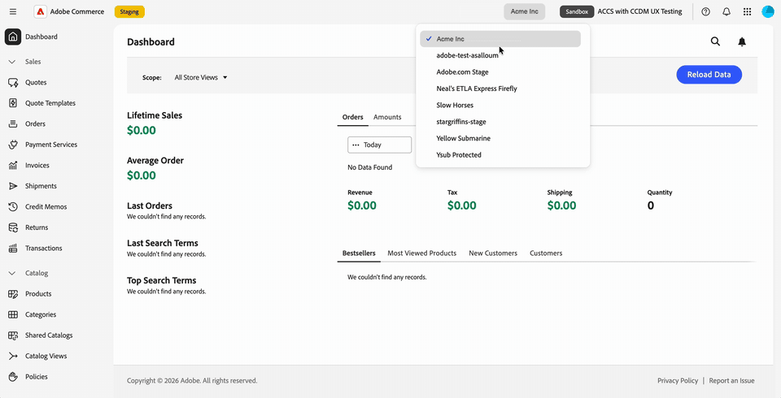
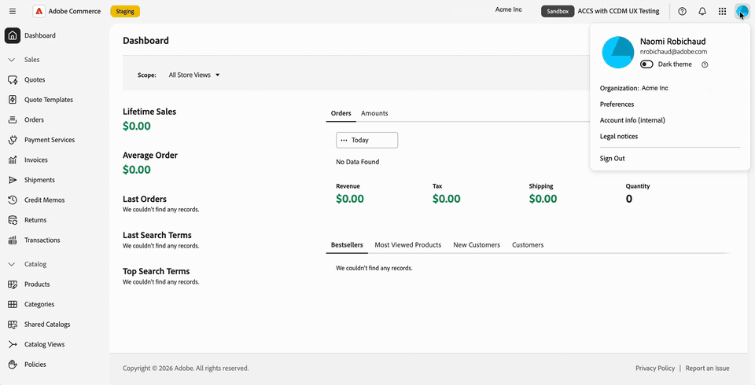

# Adobe Unified Experience中的Commerce Admin

当您在Commerce Manager中选择实例名称时，将在Adobe Unified Experience中打开Adobe Commerce as a Cloud Service的Commerce Cloud管理员。

Adobe Unified Experience界面提供了在Adobe产品中使用的共享顶部导航、更新的左侧导航以及更新的管理员页面样式。

您可以在组织、产品和Commerce实例之间切换，并从顶部导航中访问帮助、通知和帐户首选项。 您现有的Commerce角色权限将继续确定您可以访问的管理员菜单项。

>[!NOTE]
>
>Adobe Unified Experience中的Commerce Admin仅适用于Adobe Commerce as a Cloud Service。 云基础架构上的Adobe Commerce和Adobe Commerce本地客户继续使用[经典Commerce管理UI](admin.md)。

{width="800" zoomable="yes" border="light"}

## 打开Commerce Admin

登录[Adobe Experience Cloud](https://experience.adobe.com/){target="_blank"}后，打开Commerce Cloud Manager。 然后，选择一个实例以在Unified Experience中打开管理员。

登录流程允许您在Commerce实例之间移动，而无需单独登录每个实例。
您可以在Adobe产品和Commerce实例之间移动，而无需进一步的登录提示。

有关访问过程，请参阅&#x200B;_Adobe Commerce as a Cloud Service指南_&#x200B;中的[访问实例](https://experienceleague.adobe.com/zh-hans/docs/commerce/cloud-service/getting-started#access-an-instance){target="_blank"}。

>[!BEGINTABS]

>[!TAB 从Commerce Cloud Manager  打开管理员]

{width="800" zoomable="yes" border="light"}

>[!TAB 在操作中查看它]

从Commerce Cloud Manager {width="800" zoomable="yes" border="light"}

>[!ENDTABS]

### 选择管理员界面 {#classic-ui}

对于Unified Experience中的Commerce Admin的初始版本，Adobe Commerce as a Cloud Service支持两个Commerce管理体验，即Adobe Unified Experience和经典UI。

默认情况下，当您在Commerce Cloud Manager中选择Commerce实例时，Commerce管理员会在Adobe Unified Experience中打开。 要切换回经典UI，请使用现有书签或查找经典UI的URL。 请参阅[打开经典UI](#open-classic-ui)。

Unified Experience UI和Classic UI的链接在Commerce Cloud Manager的实例详细信息面板中提供。

| 链接 | 体验 |
| --- | --- |
| **[!UICONTROL Admin URL (Unified Shell UI)]** | 在Unified Experience中打开管理员。 |
| **[!UICONTROL Admin URL (Classic UI)]** | 打开上一个管理员界面。 |

{width="800" zoomable="yes" border="light"}

_基于实例列表屏幕截图和更新的实例详细信息设计的插图。 显示的URL使用暂存主机。_

#### URL格式

| 体验 | URL模式 |
| --- | --- |
| Unified Experience | `https://<experience-cloud-host>/#/@<organization>/in:<instance-id>/commerce/cloud-service/admin` |
| 经典UI | `https://<commerce-admin-host>/<instance-id>/admin/` |

Unified Experience在`@`之后标识组织，在`in:`之后标识实例。 经典UI将实例ID直接放在主机名之后。

例如，这些暂存URL会打开同一实例：

- **统一体验**： `https://experience-stage.adobe.com/#/@adobe-commerce-uex/in:<instance-id>/commerce/cloud-service/admin`
- **经典UI**： `https://na1-stage.admin.commerce.adobe.com/<instance-id>/admin/`

这些暂存主机名不是生产URL。 始终使用来自Commerce Cloud Manager的实例链接，而不是构建URL。

#### 打开经典UI

要打开经典UI，请执行以下操作：

- 使用现有的经典管理书签或URL。 这些URL仅打开经典UI，不会重定向到统一体验。
- 在Commerce Cloud Manager实例详细信息中选择&#x200B;**[!UICONTROL Admin URL (Classic UI)]**。

Admin内部没有接口开关。 使用Commerce Cloud Manager或保存的管理员URL返回经典界面（如果需要）。

## 识别您的组织和实例

在进行更改之前，请检查您正在使用的组织和实例：

- 帐户菜单显示您当前的组织。
- 顶部导航中的实例切换器显示实例名称和&#x200B;**[!UICONTROL Production]**&#x200B;或&#x200B;**[!UICONTROL Sandbox]**&#x200B;徽章。

在实例之间切换时，使用环境徽章区分生产实例和沙盒。

## 切换组织、产品和实例

顶部导航提供了用于切换工作上下文的单独控件。

### 切换组织

使用顶部导航中的组织切换器，在您有权访问的组织之间移动。

1. 在顶部导航中，选择组织名称。

1. 从列表中选择一个组织。

   该列表显示了您有权访问的组织。 复选标记用于标识您正在处理的组织。

>[!BEGINTABS]

>[!TAB 组织切换器]

{width="800" zoomable="yes" border="light"}

>[!TAB 在操作中查看它]

{width="800" zoomable="yes" border="light"}

>[!ENDTABS]

帐户菜单还会显示您正在处理的组织。 在顶部导航中选择您的个人资料图片（{width="24"}），然后检查&#x200B;**[!UICONTROL Organization]**&#x200B;行。

显示当前组织的{width="800" zoomable="yes" border="light"}

您可以打开的实例属于您正在处理的组织。 要更改实例，请参阅[切换Commerce实例](#switch-commerce-instances)。

### 切换产品

使用顶部导航中的产品切换器（{width="24"}）随时更改应用程序。 它的工作方式与其他Adobe产品相同。

- **Admin Console**：从产品切换器中打开Adobe Admin Console以管理用户及其访问权限(**[!UICONTROL Administer]** > **[!UICONTROL Users]**)。 您无需记住URL。 Adobe Admin Console与Commerce管理员不同，您可以在其中管理您的商店。
- **Adobe Exchange**：查找跨Adobe Creative Cloud、Adobe Experience Cloud和Adobe Document Cloud的第三方扩展、插件、脚本和企业集成。
- **其他产品**：打开同事等产品。

>[!BEGINTABS]

>[!TAB 产品切换器菜单]

{width="800" zoomable="yes" border="light"}

>[!TAB 在操作中查看它]

{width="800" zoomable="yes" border="light"}

>[!ENDTABS]

有关Adobe Commerce as a Cloud Service用户和角色管理，请参阅[用户管理](https://experienceleague.adobe.com/zh-hans/docs/commerce/cloud-service/user-management){target="_blank"}。

### 切换Commerce实例

顶部导航包括一个实例切换器按钮。 它始终显示&#x200B;**[!UICONTROL Production]**&#x200B;或&#x200B;**[!UICONTROL Sandbox]**&#x200B;徽章以及您所在的实例的名称。

1. 在顶部导航中，选择显示当前实例名称和环境徽章的实例切换器。

1. 从列表中选择一个实例。

   该列表包含您可以在当前组织中访问的Adobe Commerce as a Cloud Service实例。 您无需返回Commerce Cloud Manager即可切换实例，因此可以在实例之间来回移动。

1. 在继续工作之前，请检查实例名称和环境徽章。

实例是页面URL的一部分，因此您可以为打开特定实例的链接添加书签或共享该链接。 如果打开管理员时链接中没有实例，则它会加载您使用的最后一个实例。

## 使用左侧导航

Commerce管理菜单显示在Adobe Unified Experience的左侧导航区域中。 展开或折叠菜单部分以查找所需的工具，或键入以跳转到菜单项。

该菜单特定于您正在处理的实例。 切换实例时，左侧导航会更新以匹配实例。

您现有的角色权限将会延续。 您只会看到您的角色允许的菜单项。

继续使用《管理员指南》执行管理产品、订单、客户和配置等任务。 管理员页面已刷新样式，因此其外观可能与本指南中经典UI的屏幕快照不同。

>[!BEGINTABS]

>[!TAB Commerce管理员左侧导航]

{width="800" zoomable="yes" border="light"}

>[!TAB 在操作中查看它]

{width="800" zoomable="yes" border="light"}

>[!ENDTABS]

## 获取帮助并提供反馈

要在不离开Commerce管理员的情况下访问资源，请使用顶部导航栏中的帮助图标（{width="24"}）打开帮助面板。

- **帮助**：直接从面板搜索Adobe Experience League以获取文档。
- **支持**：访问社区论坛和其他学习资源，并在Adobe Experience League上查找您的支持工单。
- **反馈**：将反馈从同一面板提交到Adobe。

在上下文中提供了帮助、支持和反馈。 您可以留在Commerce管理员中，不会失去您的位置。

>[!BEGINTABS]

>[!TAB 帮助面板]

{width="800" zoomable="yes" border="light"}

>[!TAB 在操作中查看它]

{width="800" zoomable="yes" border="light"}

>[!ENDTABS]

## 查看通知 {#view-notifications}

若要查看上下文中的通知、请求和产品公告，请使用顶部导航中的铃铛图标（{width="24"}）打开通知面板。

该面板将您的&#x200B;**[!UICONTROL Requests]**、**[!UICONTROL Notifications]**&#x200B;和&#x200B;**[!UICONTROL Announcements]**&#x200B;集中在一起。 您无需离开Commerce管理员即可查看任何这些幻灯片。

在此面板的Unified Experience顶部导航中使用铃铛图标，而不是Commerce页面标题中的通知控件。 有关Commerce管理员收件箱邮件的说明，请参阅[邮件收件箱](admin-message-inbox.md)。

>[!BEGINTABS]

>[!TAB 通知面板]

{width="800" zoomable="yes" border="light"}

>[!TAB 在操作中查看它]

{width="800" zoomable="yes" border="light"}

>[!ENDTABS]

## 管理帐户首选项

在顶部导航中选择您的个人资料图片（{width="24"}）以打开帐户菜单。 通过此菜单，您可以：

- 查看您正在处理的组织。
- 使用&#x200B;**[!UICONTROL Dark theme]**&#x200B;切换开关打开深色模式。
- 打开您的用户偏好设置。

>[!BEGINTABS]

>[!TAB 具有深色模式的 帐户菜单]

具有深色模式的{width="800" zoomable="yes" border="light"}

>[!TAB 在操作中查看它]

具有深色模式的{width="800" zoomable="yes" border="light"}

>[!ENDTABS]

## 更新了页面样式

Commerce管理员中的页面具有与Adobe Unified Experience匹配的已刷新外观。 计划在更高版本中进行更多重新样式设置。

>[!MORELIKETHIS]
>
>[Adobe CX Enterprise界面和管理指南](https://experienceleague.adobe.com/zh-hans/docs/core-services/interface/experience-cloud)
