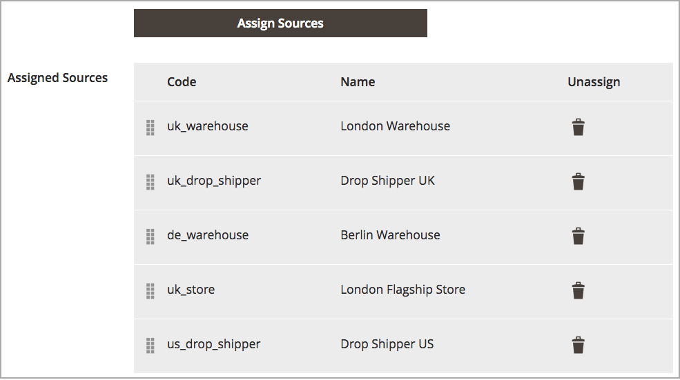

# 配置Source优先级算法

自定义库存包括指定的来源列表，这些来源通过您的店面销售和发运可用的产品库存。 此算法使用库存中的已分配源顺序进行推荐。

运行时，算法将：

- 从顶部开始按照库存级别的已配置来源顺序工作

- 根据列表中的订单、可用数量和订购数量，建议每个产品的发运数量和来源

- 在订单装运完成之前继续沿列表向下移动

- 如果在列表中找到已禁用的源，则跳过该源

要配置，请按照从上到下的优先级排列这些来源以完成订单。 Source选择算法(SSA)在确定发运和库存扣减额时提供了使用此订单的算法“优先级”。 请参阅[优先处理股票的来源](stocks-prioritize-sources.md)。

## 配置源的优先级

1. 在&#x200B;_管理员_&#x200B;侧边栏上，转到&#x200B;**[!UICONTROL Stores]** > **[!UICONTROL Inventory]** > **[!UICONTROL Stocks]**。

1. 在编辑模式下打开股票并导航到&#x200B;_[!UICONTROL Sources]_区域。

1. 单击&#x200B;**[!UICONTROL Assign Sources]**。

1. 在&#x200B;_[!UICONTROL Assign Sources]_视图中，选中所需源的复选框，然后单击&#x200B;**[!UICONTROL Done]**将源分配给库存。

>[!NOTE]
>
>在使用[距离优先级](distance-priority-algorithm.md)算法进行装运时，如果对于装运所选的[计算模式](distance-priority-algorithm.md)（驾驶、骑车或行走）未返回工艺路线和数据，则SSA默认使用Source优先级。

在优先级设置后

| 图标 | 描述 |
|----------------------------------------------|----------------------------------------------------------------|
|  | 用于根据优先级拖放源。 |
|  | 为库存取消分配源。 |
