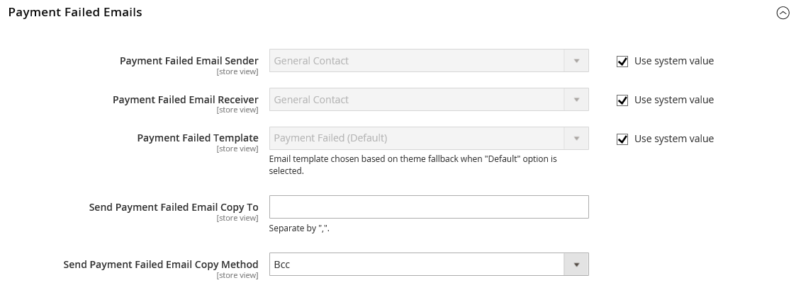

# 付款失败通知

如果在结账期间选择的支付方式无法完成交易，则向商店联系人或指定的管理员用户发送通知。

## 步骤1：更新电子邮件模板

确保更新了所需的电子邮件模板以反映您的品牌。 有关模板的完整列表，请参阅[电子邮件模板列表](../systems/email-templates.md#email-template-list)。

## 步骤2：配置付款失败的电子邮件

1. 在&#x200B;_管理员_&#x200B;侧边栏上，转到&#x200B;**[!UICONTROL Stores]** > **[!UICONTROL Configuration]**。

1. 在左侧面板上，展开&#x200B;**[!UICONTROL Sales]**&#x200B;并选择&#x200B;**[!UICONTROL Checkout]**。

1. 展开&#x200B;**[!UICONTROL Payment Failed Emails]**&#x200B;部分的。

   {width="600" zoomable="yes"}

1. 设置付款失败电子邮件的选项：

   - 将&#x200B;**[!UICONTROL Payment Failed Email Sender]**&#x200B;设置为显示为邮件发件人的商店联系人。
   - 将&#x200B;**[!UICONTROL Payment Failed Email Receiver]**&#x200B;设置为要接收电子邮件传输失败通知的存储联系人。
   - 将&#x200B;**[!UICONTROL Payment Failed Template]**&#x200B;设置为在结帐期间付款方法失败时发送的电子邮件所使用的模板。

1. 对于&#x200B;**[!UICONTROL Send Payment Failed Email Copy To]**，请输入要接收付款失败通知副本的所有人的电子邮件地址。

   如果向多个收件人发送副本，请使用逗号分隔每个地址。

1. 将&#x200B;**[!UICONTROL Payment Failed Copy Method]**&#x200B;设置为以下项之一：

   - `Bcc` — 通过在发送给客户的同一电子邮件的标头中包含收件人，发送&#x200B;_免费副本_。 客户看不到密件抄送收件人。
   - `Separate Email` — 将副本作为单独的电子邮件发送。

1. 单击&#x200B;**[!UICONTROL Save Config]**。
